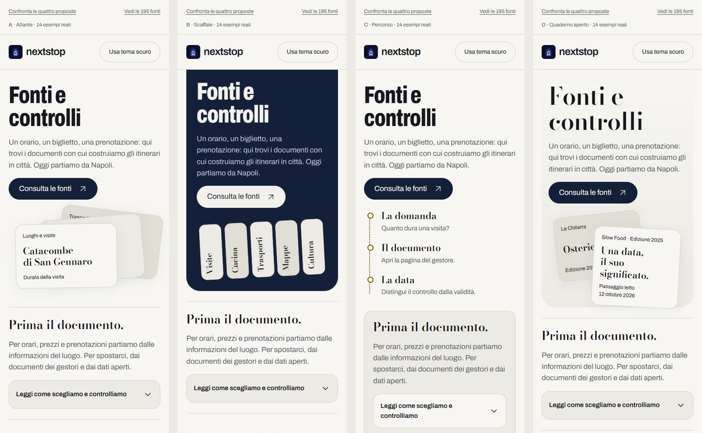
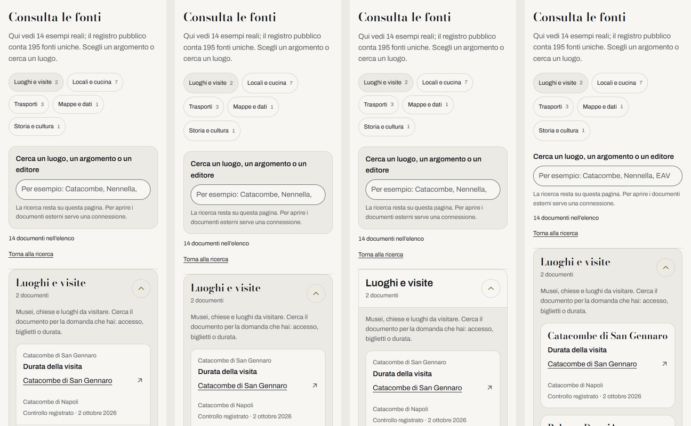

# Pagina generale /fonti/ · quattro proposte isolate

Blocco 4 autorizzato il 12/10/2026, sul ramo `codex/fonti-specifica` da `f9af5d4`. D del pannello, giro 4, approvata e conservata. Nessuna integrazione nel sito.

## Direzioni, prima della costruzione

Pattern: **List / Index**, adattato a un registro editoriale pubblico; niente gestione dei record, esportazione del registro o paginazione obbligatoria. Gruppi indipendenti secondo la specifica di Nextstop, documenti a un clic. Le regole del progetto prevalgono sul catalogo generico delle skill.

Palette comune: carta `#F7F6F2`, pietra `#ECEAE4`, riga `#D6D2C8`, inchiostro `#16181D`, notte `#142039`, tufo `#E0A51B`. Temi da DESIGN.md; Archivo per testo a 17 px e titolo compatto, Bodoni Moda per sezioni e quaderno. Font locali e licenze esistenti. Testi allineati a sinistra, righe al massimo 70 caratteri, confini e angoli della D.

| Proposta | Struttura | Momento di movimento |
|---|---|---|
| A · Atlante | Apertura in due colonne; indice laterale; capitoli e documenti in righe ampie | Tre fogli si separano nello spazio mentre l'apertura scorre |
| B · Scaffale | Apertura notte; cinque dorsi riconoscibili; argomenti come fogli larghi indipendenti | I dorsi compongono un fascicolo; all'apertura il foglio si assesta |
| C · Percorso | Domanda, documento e data in una sequenza breve; registro su una colonna | Una linea collega i tre passi con lo scorrimento |
| D · Quaderno aperto | Apertura con le grazie; metodo essenziale; riquadri per luogo, come la D approvata | Due pagine sovrapposte si aprono leggermente, senza muovere i controlli |

Critica del piano: i riquadri sono motivati dai gruppi della D, non usati per spezzare ogni frase. Nessun numero celebrativo in apertura, etichette in maiuscolo, logo di editori o foto necessaria. Il gesto forte riguarda solo l'apertura; il registro resta fermo e leggibile. La ricerca nuova è sobria: la rifinitura della barra della D resta successiva.

Materiali: [specifica](../../../../specifiche/fonti-e-controlli.md), [testi](../../../../ricerca/2026-10-12-fonti-testi-bozza.md), [D approvata](../../giro-4/README.md). I campioni includono documenti originali della ricerca già svolta; non sono una nuova verifica delle fonti. Le categorie sono proposte di organizzazione, non nuove prove editoriali.

## Apri e confronta

[Confronto delle quattro proposte](index.html). Server di sola lettura su [127.0.0.1:4347](http://127.0.0.1:4347/design/fonti/pagina-generale/giro-1/index.html).

| Proposta | Campione | Tutto il registro | Differenza e limite |
|---|---|---|---|
| **A · Atlante, consigliata** | [14 esempi](a.html) | [195 fonti](a-lungo.html) | Indice a sinistra sul desktop, capitoli a destra. I fogli in profondità riprendono la D; sul telefono l'indice diventa una serie di collegamenti. Buon equilibrio tra orientamento e identità. |
| B · Scaffale | [14 esempi](b.html) | [195 fonti](b-lungo.html) | Apertura notte e dorsi; nel registro, luogo e documento su due colonne sul desktop. La più scenografica; richiede più spazio in apertura sul telefono. |
| C · Percorso | [14 esempi](c.html) | [195 fonti](c-lungo.html) | Domanda, documento, data: il metodo entra nell'apertura. Registro su una colonna e titoli più pratici. Facile da capire, meno vicina al quaderno scelto. |
| D · Quaderno aperto | [14 esempi](d.html) | [195 fonti](d-lungo.html) | Titolo con le grazie, due fogli e gruppi per luogo dentro gli argomenti. Massima continuità con il pannello; sul registro lungo aggiunge un livello di raggruppamento. |





Il campione apre Luoghi e visite per mostrare le voci; il registro completo parte con cinque argomenti chiusi e indipendenti. Ricerca e originali restano immediati; il rinvio dai dati agli autobus apre la fonte canonica ANM. Un documento condiviso fra luoghi compare una volta ed è cercabile da ciascun luogo. Nessun limite arbitrario al numero di documenti.

La fascia con conteggio e ritorno alla ricerca resta disponibile mentre scorri; durante la digitazione torna statica. Il valore della ricerca si conserva nella cronologia della sola scheda durante andata/ritorno. Nessun cookie, archivio locale, dato personale o scrittura negli itinerari. Senza JavaScript tutti i titoli originali e i 195 collegamenti restano consultabili attraverso gli argomenti.

## Contenuti e limiti

- Il registro completo conserva **195 ID, titoli originali, URL e date registrate** da `src/data/fonti.yaml`, con l'esclusione esistente. Non aggiunge i tre documenti alternativi del campione al registro del sito.
- Il campione contiene i 12 esempi della D, OpenStreetMap e il riferimento già registrato alla genovese. I tre ID `bozza-*` restano fixture: documenti reali della ricerca precedente, non nuovi record pubblicati. Nessuna nuova lettura esterna dichiarata.
- Le letture documentate nel Blocco 2 restano distinte dal controllo registrato; nessuna data aggregata o promozione di una lettura parziale a conferma. ANM resta un download ZIP con IODL 2.0; PDF EAV, annunci, edizioni e limiti conservati.
- Nei 195 documenti, **185 descrizioni della relazione fonte–informazione restano da completare** nel Blocco 5. Le 171 del pannello lungo della D rimangono il suo conteggio separato. Nessun segnaposto interno esposto al visitatore; titolo, editore, date e note reali restano leggibili.
- Categorie e ordine sono proposte editoriali: il raggruppamento non dimostra che ogni documento sostenga tutti gli argomenti del luogo. Nessuna classificazione fattuale nuova dedotta dal dominio.
- Ricerca visiva della D del giro 4 ancora rimandata, senza modifiche a quel pannello. Nessuna prova con lettori esterni, installazione, delega, push, merge o deploy.

## Riproduzione locale

```powershell
$env:PATH = 'C:\Users\Windows11\tools\node-v24.21.0-win-x64;' + $env:PATH
node design/fonti/pagina-generale/giro-1/genera.mjs
node design/fonti/pagina-generale/giro-1/serve.mjs
```

In un secondo terminale, con lo stesso PATH: `node design/fonti/pagina-generale/giro-1/verifica.mjs`, poi `movimento.mjs`, `lighthouse.mjs`, `fotografa.mjs` e `conservazione.mjs` nello stesso percorso. Lighthouse va eseguito **da solo**. Chrome usa profili temporanei; le prove intercettano il documento esterno con una risposta fittizia e bloccano le richieste esterne. Non verificano la raggiungibilità odierna degli editori.

**Controlli:** 58/58 test del sito, build riuscita, 874 link interni validi; [160 combinazioni, 64 scansioni axe pulite, 64 ricerche](verifiche/risultati.json), tastiera, titoli, originali/ritorno e stato fittizio conservato, movimento ridotto, assenza di JS, nessuna richiesta esterna prima del clic. [24 casi e 96 fotogrammi di movimento](verifiche/movimento.json), [Tab attraverso il contenuto rinviato](verifiche/tastiera-confine.json), immagini a 375/390/1280 px in entrambi i temi. Testo primario 17 px e bersagli almeno 44 px; nessun overflow a 320/375/390/768/1280 px. [Lighthouse mobile sul registro completo](verifiche/lighthouse-riepilogo.json): obiettivo almeno 95, accessibilità e buone pratiche 100. [Prime misure insufficienti conservate](verifiche/lighthouse-primo-riepilogo.json), [riproduzione del problema del primo Tab](verifiche/tastiera-prima.json).

Lighthouse finale: **A 97/97, B 96/96, C 96/96, D 98/98**, chiaro/scuro; accessibilità e buone pratiche 100 in tutte le otto misure.

[279 riferimenti locali e ancore](verifiche/riferimenti.json) validi in documentazione, prototipi e confronto. Gli 851 riferimenti esterni presenti nelle copie non sono stati ricontrollati sul web.

[Conservazione](verifiche/conservazione.json): 166 input di `src/` e `public/` invariati, 373 file dei precedenti giri delle fonti invariati; 1113 dei 1115 file complessivi confrontati identici. Due hash diversi in file preesistenti **non tracciati** del compositore, con date di modifica precedenti al blocco, registrati senza ripristini né inclusione nel commit. Nessun comando di questo blocco scrive in quelle cartelle; il controllo complessivo non viene dichiarato interamente riuscito. [Resoconto](../../../../docs/storico/2026-10-12-fonti-blocco-4.md).

Riferimenti tecnici primari consultati in alternativa al download della skill: [MDN, disclosure nativi](https://developer.mozilla.org/en-US/docs/Web/HTML/Reference/Elements/details), [movimento ridotto](https://developer.mozilla.org/en-US/docs/Web/CSS/Reference/At-rules/@media/prefers-reduced-motion), [animazioni con lo scorrimento](https://developer.mozilla.org/en-US/docs/Web/CSS/Reference/Properties/animation-timeline), [contenuti fuori vista](https://developer.mozilla.org/en-US/docs/Web/CSS/Reference/Properties/content-visibility). Il rinvio del disegno riguarda solo il registro sotto la prima schermata, con altezza stimata e alternativa statica; il fallback della proprietà è simulato, non una prova su un altro browser.
