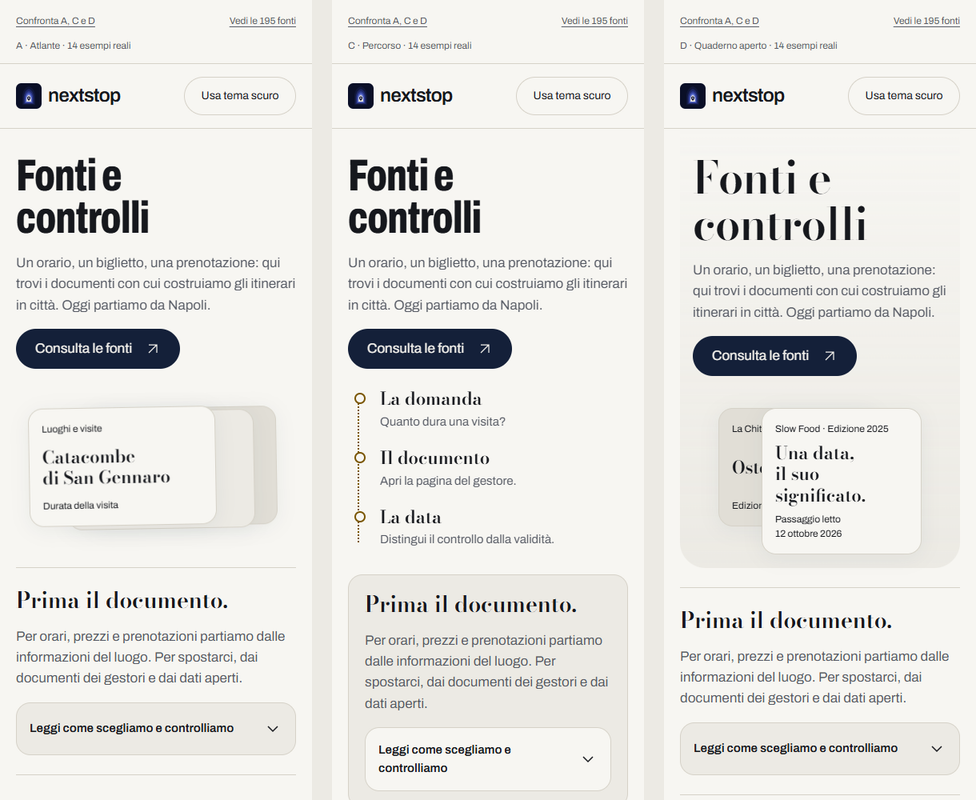
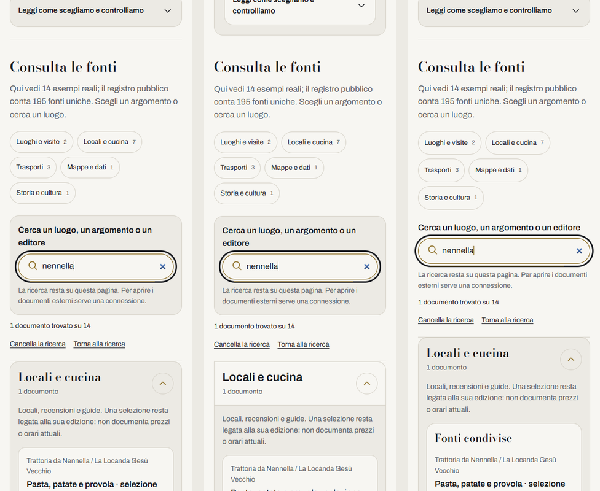

# Pagina generale Fonti · giro 2, A/C/D e ricerca con movimento

## Ricerca: intervento interrotto

12 ottobre 2026, dopo `be89e9f`: Enrico giudica troppo poco visibile la prima rifinitura e poi interrompe il nuovo tentativo perché non gli piace. **La nuova barra non è approvata; nessun ulteriore lavoro sulla ricerca.** Le anteprime A/C/D sono riportate alla versione già committata `be89e9f`, con le migliorie dell'audit conservate.

Tentativo archiviato nella [patch dei quattro file](verifiche/ricerca-non-approvata.patch) e nelle immagini `verifiche/ricerca-prima-*` / `ricerca-dopo-*`. Il [confronto](verifiche/ricerca-prima-dopo.png) mostra il disegno respinto, non un'anteprima da approvare. Controlli già terminati prima dell'interruzione: [29 test mirati](verifiche/test-rifinitura.log), [58 test del sito](verifiche/test-sito-rifinitura.log), [build](verifiche/build-rifinitura.log), [874 link interni](verifiche/link-sito-rifinitura.log), 120 combinazioni UI/20 axe e 48 casi di movimento senza errori. Lighthouse del nuovo tentativo non eseguita; valgono per le anteprime ripristinate le misure del giro già concluso riportate sotto. Nessuna nuova verifica degli originali.

**Scelta successiva esplicita di Enrico: A · Atlante.** Il [campione A](a.html) contiene 14 esempi, di cui due fonti per Visite e sette per Cucina; il [registro completo A](a-lungo.html) contiene 195 documenti unici: 94 Visite, 69 Cucina, 17 Trasporti, 1 Mappe, 14 Cultura. Questi numeri contano fonti, non luoghi. Nel Blocco 5 usare il registro completo insieme alla D del pannello approvato. Il blocco verrà avviato nella nuova sessione; nessuna integrazione o pubblicazione eseguita qui.

12 ottobre 2026. Enrico approva i quattro interventi dell'[audit](../../../../ricerca/2026-10-12-fonti-pagina-revisione-critica.md) e conferma i tre comportamenti della ricerca: attivazione del campo, cambio di conteggio/risultati, ritorno all'elenco. Nuove copie isolate di **A, C e D**; B e il giro 1 conservati. Nessuna direzione generale ancora selezionata per l'integrazione. **La D del pannello a fondo pagina, giro 4, è un altro pezzo e resta invariata**, compreso il suo intervento futuro sulla ricerca.

## Disegno e movimento

Pattern conservato: registro **List / Index**, argomenti indipendenti e documenti diretti. Palette carta `#F7F6F2`, pietra `#ECEAE4`, inchiostro `#16181D`, notte `#142039`, tufo `#E0A51B`, con corrispondenti scuri di DESIGN. Archivo 17 px nel registro, Bodoni nelle sezioni; allineamento a sinistra e righe leggibili. Aperture e identità distinte dei tre bozzetti conservate.

Il movimento risponde ai gesti sulla ricerca, con la riga del quaderno come riferimento visivo:

1. **Tocco o focus:** la lente si sposta di 2 px e una riga color tufo si distende sotto il campo, in 200 ms. Il campo conserva larghezza e altezza; caret, label e anello del focus restano leggibili.
2. **Digitazione:** il conteggio scorre di 6 px in 150 ms; i risultati si assestano di 8 px in 200 ms, con opacità da 0,92 a 1. Filtro applicato subito, nessuna attesa aggiunta o finta operazione di caricamento.
3. **Cancella la ricerca:** ritorno dell'elenco in 200 ms, pannelli manuali ripristinati, focus alla ricerca. La riga rimane attiva finché il campo ha focus.

Critica del piano: animare dimensioni del campo avrebbe disturbato la digitazione; mantenuto lo spazio fisso e concentrato il gesto su lente/riga e cambio dei risultati. Nessun movimento perpetuo, rimbalzo o sequenza automatica per ogni documento. **Riduci movimento:** cambi immediati, senza traslazioni animate. Cambio della preferenza durante la pagina gestito; senza `Element.animate()` il filtro funziona comunque.

## Prova le tre direzioni

[Confronto nel browser locale](http://127.0.0.1:4348/design/fonti/pagina-generale/giro-2/index.html) · [file del confronto](index.html).

| Direzione | 14 esempi | 195 fonti | Differenza |
|---|---|---|---|
| **A · Atlante, consigliata** | [Apri A](a.html) | [Registro A](a-lungo.html) | Indice a lato sul desktop e registro per documento; equilibrio fra orientamento e identità. |
| C · Percorso | [Apri C](c.html) | [Registro C](c-lungo.html) | Metodo spiegato in apertura, lettura lineare; ricerca con la stessa risposta al gesto. |
| D · Quaderno aperto | [Apri D](d.html) | [Registro D](d-lungo.html) | Riquadri per luogo e continuità con il quaderno; rimane una proposta della pagina generale. |





Per vedere le tre fasi: raggiungi la ricerca, scrivi «Nennella» o «trasporti», poi premi «Cancella la ricerca». Apri prima due argomenti per provare il ripristino. [Sedici fotogrammi di D](verifiche/movimento.json) fermano le animazioni del browser ai loro tempi per la cattura; non sono una registrazione video o una prova con persone.

## Quattro interventi applicati alle anteprime

- **Navigazione/stato:** focus sotto la fascia misurata, indice con selezione coerente, hash malformati ignorati, pannelli precedenti alla ricerca conservati anche nella cronologia della scheda. Il comando ora dice «Cancella la ricerca».
- **Categorie:** metadati espliciti separati dai luoghi, sette documenti EAV/Caremar ricollocati in Trasporti; 94 Visite, 69 Cucina, 17 Trasporti, 1 Mappe, 14 Cultura. Rinvii dagli argomenti ai record canonici, senza duplicare documenti o conteggi. Tipo della fonte conservato quando disponibile nei record originali; non equivale a conferma di ogni fatto.
- **Ricerca:** argomenti indicizzati; congiunzioni non scelgono il luogo di una fonte condivisa. In una ricerca che nomina due luoghi allo stesso modo non viene attribuita una preferenza arbitraria. Accenti, apostrofi e sinonimi esistenti conservati.
- **Crediti:** [anteprima isolata](crediti.html#foto), con 54 autori/licenze/originali, licenze cliccabili dove già disponibili, Bodoni e licenza locale. Rinviata qui dai prototipi; `/note-legali/` del sito resta invariata fino al Blocco 5. Email attuale mantenuta per scelta esplicita di Enrico.

195 ID, titoli originali, URL e date del registro conservati; campione di 14 con i tre `bozza-*` già documentati e correttamente distinto. **185 descrizioni del generale ancora nel Blocco 5**, separatamente dalle 171 del pannello lungo. Nessuna nuova verifica generale, data aggiornata, promessa di validità odierna o cambiamento a regate/calendario. Documenti esterni richiedono connessione.

## Controlli e riproduzione

Strumenti locali già presenti, Node portatile 24.21.0, Chrome temporaneo e richieste agli editori bloccate. Nessuna installazione, delega, push, merge o deploy. Controlli e limiti completi nel [resoconto](../../../../docs/storico/2026-10-12-fonti-pagina-giro-2.md).

- [Prima delle correzioni](verifiche/regressioni-prima.log): 21 casi falliscono e uno passa sul giro 1; [dopo](verifiche/regressioni-dopo.log): **22/22**. Il caso di parità tra luoghi è riprodotto separatamente prima della correzione, [5/6](verifiche/ricerca-prima.log), poi [6/6](verifiche/ricerca-dopo.log).
- [Test finali](verifiche/test-finali.log): **29/29**, compresa la regressione dell'intestazione dei crediti su telefono; [difetto prima](verifiche/crediti-prima.log), [quattro casi finali dei crediti](verifiche/crediti-finali.json).
- [Suite del sito](verifiche/test-sito.log): **58/58**; [build](verifiche/build.log) riuscita, [874 link interni](verifiche/link-sito.log) validi.
- [Verifiche UI](verifiche/risultati.json): **120 combinazioni** a 320/375/390/768/1280 px, argomenti aperti/chiusi, campione/completo e due temi; **20 axe pulite**, comprese anteprime crediti/confronto, 72 ricerche, 60 Tab, 12 ritorni dal documento fittizio e tre prove senza JS. Nessun overflow, errore JS o richiesta agli editori; storage fittizio degli itinerari conservato. Crediti nuovamente verificati dopo la correzione CSS circoscritta.
- [Movimento](verifiche/movimento.json): **48 combinazioni, 144 fasi**, campione/completo, chiaro/scuro, telefono/desktop, movimento normale/ridotto; campo con dimensioni stabili, query/focus corretti, cambio della preferenza e assenza della API animazioni provati. 16 fotogrammi salvati.
- [Lighthouse mobile completo](verifiche/lighthouse-riepilogo.json): **A 97/96, C 97/97, D 97/97**, chiaro/scuro; accessibilità e buone pratiche 100, CLS 0. [Prime misure insufficienti conservate](verifiche/lighthouse-primo-riepilogo.json); stile/misure della ricerca rinviati al primo gesto o all'arrivo al registro.
- [Conservazione](verifiche/conservazione.json): **166 input del sito e 544 file dei precedenti giri Fonti identici**; 1284/1286 file complessivi uguali alla base del giro. Due differenze di hash in vecchi artefatti della home, con date di modifica antecedenti al lavoro e nessuna differenza Git rilevata nel file tracciato: causa non attribuita, nessun ripristino o inclusione nel commit. Nessun comando del giro scrive in quei percorsi; controllo complessivo non dichiarato interamente riuscito.
- [Riferimenti locali e ancore](verifiche/riferimenti.json) validi nella documentazione e negli otto HTML del giro; collegamenti esterni non ricontrollati sul web.

La risposta fittizia dell'originale serve a provare andata/ritorno senza contattare la testata, con favicon anch'essa locale. Non dimostra raggiungibilità o correttezza odierna del documento. I test usano Chrome con viewport simulati, non telefoni fisici o altri browser; nessuna prova con lettori esterni dichiarata.

```powershell
$env:PATH = 'C:\Users\Windows11\tools\node-v24.21.0-win-x64;' + $env:PATH
node design/fonti/pagina-generale/giro-2/genera.mjs
node design/fonti/pagina-generale/giro-2/serve.mjs
```

In un secondo terminale: `node --test design/fonti/pagina-generale/giro-2/regressioni.test.mjs design/fonti/pagina-generale/giro-2/ricerca.test.mjs`, poi `verifica.mjs` e `movimento.mjs`. `lighthouse.mjs` va eseguito da solo. La generazione importa configurazione e licenze locali TypeScript con il runtime portatile documentato; non modifica quelle sorgenti.

Riferimenti primari consultati in alternativa al download richiesto da modern-web-guidance, escluso dall'autorizzazione: [Element.animate](https://developer.mozilla.org/en-US/docs/Web/API/Element/animate), [riduci movimento](https://developer.mozilla.org/en-US/docs/Web/CSS/Reference/At-rules/@media/prefers-reduced-motion), [focus non coperto](https://www.w3.org/WAI/WCAG22/Understanding/focus-not-obscured-minimum.html). Animazioni progressive, fallback immediato e nessuna libreria nuova.
